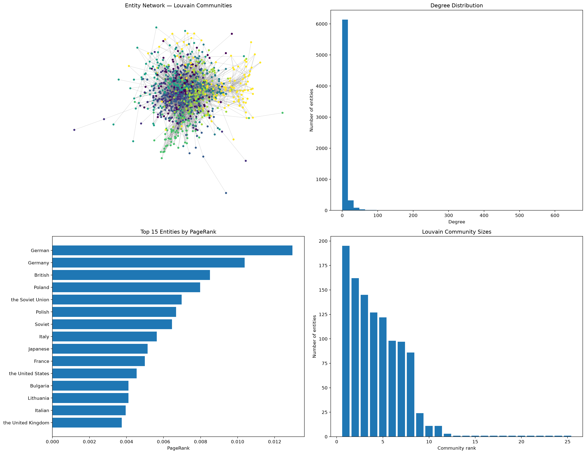

# Wikipedia Topic Graph: History & Politics

## Overview

This project explores historical and political topics through graph 
analysis of Wikipedia articles. Using Natural Language Processing (NLP) 
and Network Science, it identifies relationships between articles, named 
entities, and keywords.

The objective is to discover important entities, identify thematic 
communities, and understand the structural properties of historical and 
political information networks.

## Technologies

- **Python** – Data collection and analysis
- **NetworkX** – Graph construction and network analysis
- **spaCy** – Named Entity Recognition
- **Scikit-learn** – TF-IDF and cosine similarity
- **Pandas** – Data processing
- **Matplotlib** – Data visualization
- **PyVis** – Interactive network visualization
- **Jupyter Notebook** – Exploratory analysis

## Project Workflow

1. **Data Collection:** Retrieve 200 Wikipedia articles related to History 
and Politics.
2. **Text Processing:** Clean article content and extract named entities 
and keywords.
3. **Graph Construction:** Build three graphs:
   - Article Similarity Graph
   - Entity Co-occurrence Graph
   - Keyword Co-occurrence Graph
4. **Network Analysis:** Calculate degree, betweenness, closeness, and 
PageRank centrality.
5. **Community Detection:** Apply Greedy Modularity and Louvain 
algorithms.
6. **Visualization:** Generate static and interactive network 
visualizations.

## Key Results

- 200 Wikipedia articles collected.
- 1,831 edges in the Article Similarity Graph.
- 25,312 edges in the Entity Co-occurrence Graph.
- 260,985 edges in the Keyword Co-occurrence Graph.
- 25 communities detected using Louvain, with a modularity score of 
0.4355.
- German was the most central entity across the four centrality measures.

## Visualizations

### Static Dashboard



### Interactive Network

Open `miniproject_interactive.html` in your browser to explore the 
network.

## Repository Structure

```text
miniproject_history_politics/
├── collect_wikipedia.py
├── miniproject.ipynb
├── wikipedia_articles.json
├── entity_centrality_results.csv
├── miniproject_dashboard.png
├── miniproject_interactive.html
├── lib/
└── README.md
```

## How to Run

Clone the repository:

```bash
git clone https://github.com/Chen729689OUGK/wikipedia-topic-graph-history-politics.git
cd wikipedia-topic-graph-history-politics
```

Install the required dependencies:

```bash
pip install pandas numpy networkx matplotlib scikit-learn spacy pyvis 
jupyter
python -m spacy download en_core_web_sm
```

Launch Jupyter Notebook:

```bash
jupyter notebook
```

Open `miniproject.ipynb` and execute the cells.

## Author

Jade-Dine ALABI
Big Data Analytics Engineering Student  
Université Euromed de Fès, Morocco
